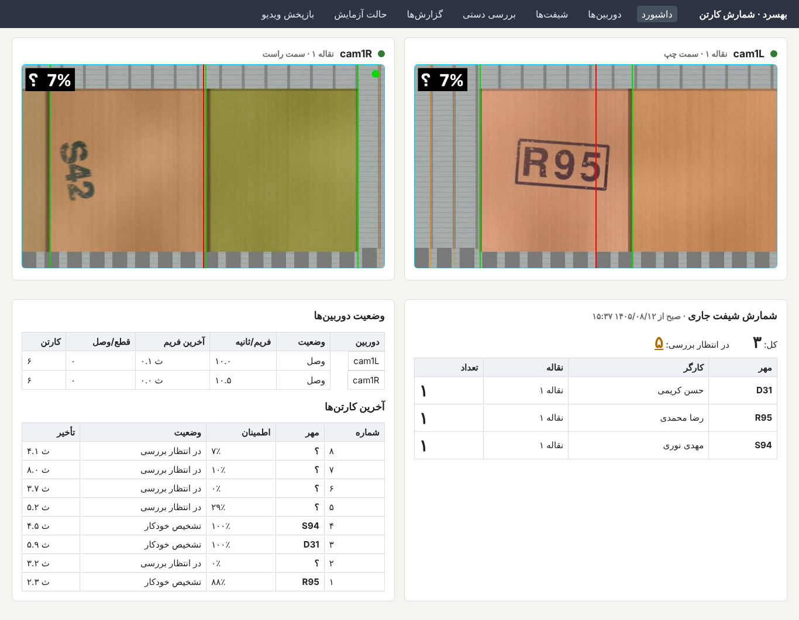
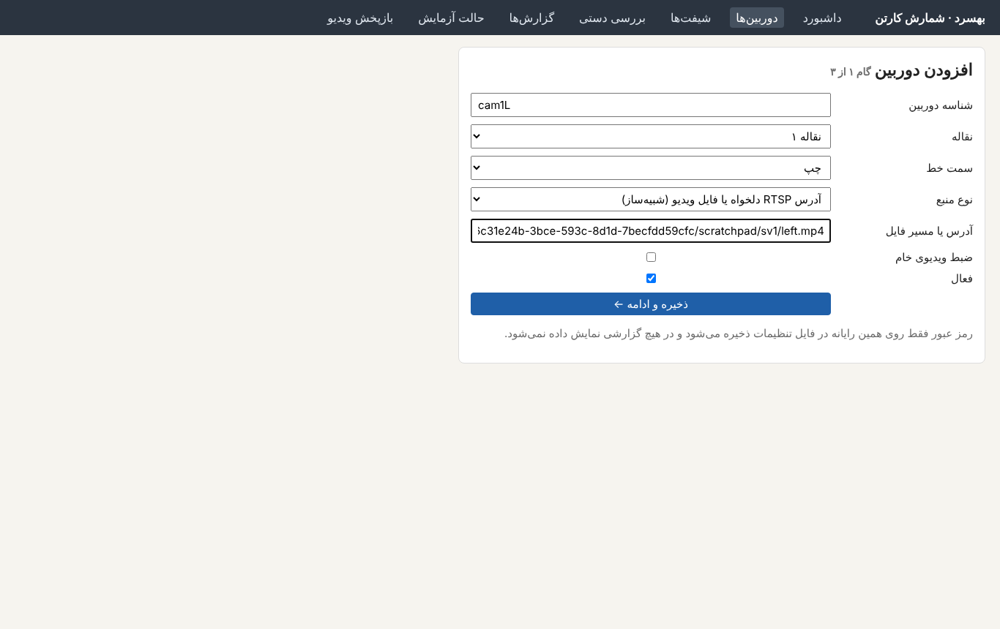
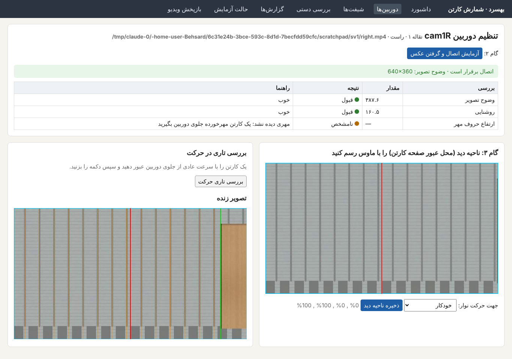
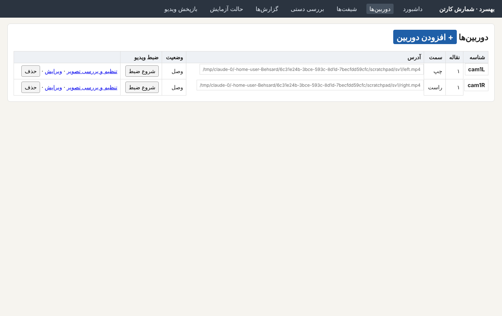
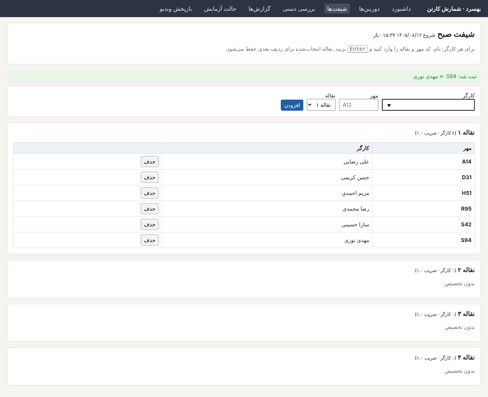
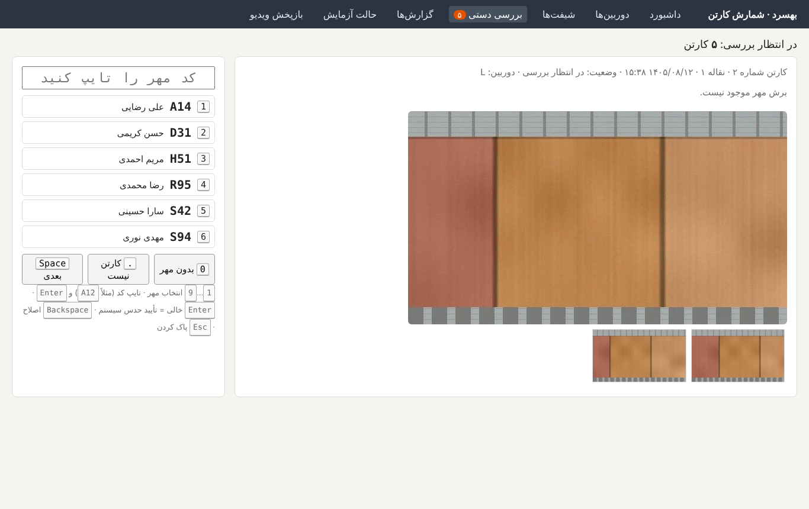
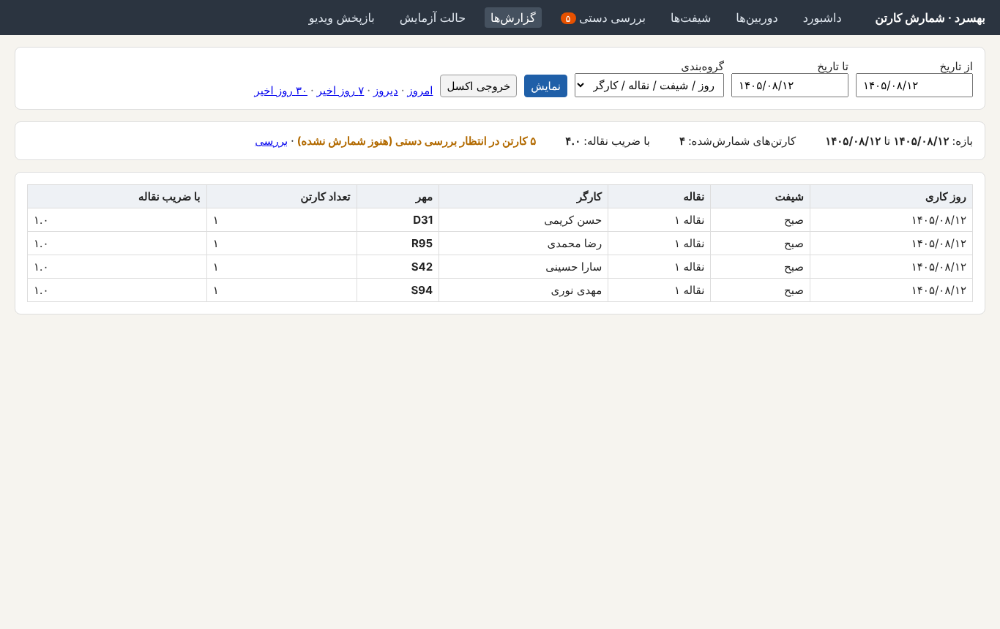
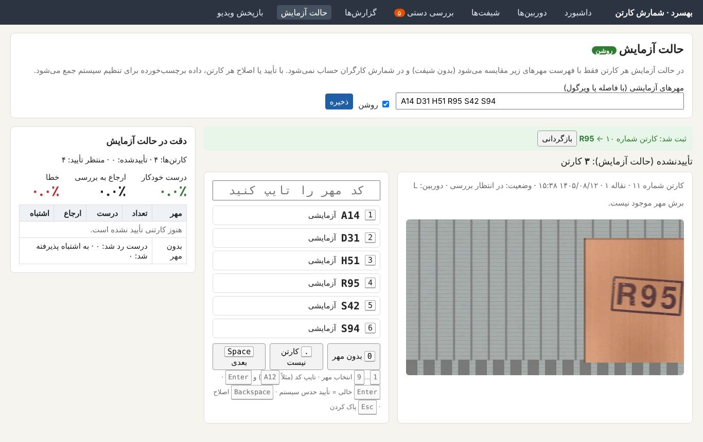
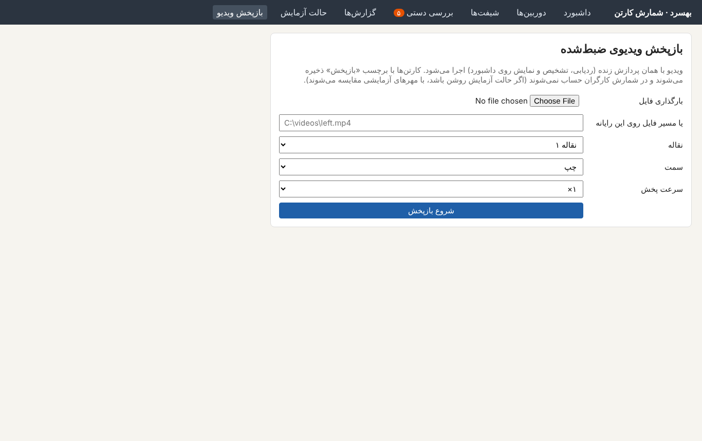

# بهسرد · شمارش خودکار کارتن

این نرم‌افزار با دوربین، مهر هر کارگر را روی کارتن‌های خروجی خط سورتینگ می‌خواند و تعداد کارتن‌های هر کارگر را در هر شیفت، روز و نقاله ثبت می‌کند. همه‌چیز روی همین رایانه و **بدون اینترنت** اجرا می‌شود.

## نصب (یک بار)

1. فایل `Behsard-windows-x64-…zip` را از صفحه Releases در گیت‌هاب دانلود کنید.
2. فایل zip را در یک پوشه ثابت باز کنید، مثلاً `C:\Behsard` (مسیر ترجیحاً بدون فاصله و حروف فارسی).
3. هیچ نصب دیگری لازم نیست: پایتون، Tesseract و ffmpeg داخل همین پوشه هستند.

## اجرا

- روی `Behsard.exe` (یا `start.bat`) دوبار کلیک کنید.
- یک پنجره سیاه (گزارش برنامه) باز می‌شود و مرورگر خودکار صفحه `http://localhost:8000` را باز می‌کند.
- **تا وقتی برنامه کار می‌کند، پنجره سیاه را نبندید.** بستن آن برنامه را متوقف می‌کند؛ اطلاعات ذخیره‌شده از بین نمی‌رود.
- اگر مرورگر باز نشد، خودتان آدرس `http://localhost:8000` را باز کنید.
- در اولین اجرا پوشه‌های `config` (تنظیمات) و `data` (پایگاه داده، تصاویر، ویدیوها و گزارش خطا) کنار برنامه ساخته می‌شوند. برای پشتیبان‌گیری همین دو پوشه کافی است.

اگر ویندوز هشدار «Windows protected your PC» داد: روی **More info** و سپس **Run anyway** بزنید (برنامه امضای دیجیتال ندارد).

## صفحه‌ها

### ۱. داشبورد (تصویر زنده)
تصویر زنده هر دوربین با ناحیه دید (کادر آبی)، خط شمارش (قرمز)، لبه کارتن‌ها (سبز) و آخرین مهر خوانده‌شده با درصد اطمینان. شمارنده‌های شیفت جاری برای هر مهر/کارگر، وضعیت دوربین‌ها و آخرین کارتن‌ها هر ۲ ثانیه به‌روز می‌شوند.

### ۲. دوربین‌ها (راه‌اندازی گام‌به‌گام)
- **افزودن دوربین:** شناسه (مثلاً `cam1L`)، نقاله، سمت خط، آدرس IP، نام کاربری و رمز دوربین. برای آزمایش بدون دوربین می‌توانید «آدرس دلخواه یا فایل ویدیو» را انتخاب کنید (دوربین شبیه‌سازی‌شده).
- **آزمایش اتصال:** یک عکس از دوربین گرفته می‌شود و وضوح، روشنایی و اندازه حروف مهر بررسی می‌شود (قبول/رد با راهنما).
- **ناحیه دید:** روی عکس با ماوس کادری بکشید که فقط صفحه کارتن در حال عبور را بپوشاند و «ذخیره ناحیه دید» را بزنید.
- **تاری حرکت:** یک کارتن را عبور دهید و «بررسی تاری حرکت» را بزنید.
- رمز دوربین فقط روی همین رایانه ذخیره می‌شود و هیچ‌جا نمایش داده نمی‌شود.

### ۳. شیفت‌ها
در شروع هر شیفت: «شروع شیفت»، سپس برای هر کارگر نام، کد مهر (مثل `A12`) و نقاله را وارد کنید و Enter بزنید. با «کپی تخصیص‌ها» می‌توانید تخصیص‌های شیفت قبل را یک‌جا بیاورید. در پایان شیفت «بستن شیفت» را بزنید.

### ۴. بررسی دستی
کارتن‌هایی که سیستم با اطمینان کافی نخوانده است اینجا می‌آیند. با صفحه‌کلید:
`1` تا `9` انتخاب مهر · تایپ کد و `Enter` · `Enter` خالی = تأیید حدس سیستم · `0` بدون مهر · `.` کارتن نیست · `Space` بعدی. دکمه «بازگردانی» آخرین تصمیم را لغو می‌کند.

### ۵. گزارش‌ها
بازه تاریخ شمسی و نوع گروه‌بندی (کارگر، شیفت، روز، نقاله) را انتخاب کنید. «خروجی اکسل» یک فایل اکسل راست‌به‌چپ با همه جدول‌ها می‌دهد. کارتن‌های «در انتظار بررسی» تا تعیین تکلیف شمارش نمی‌شوند.

### ۶. حالت آزمایش
برای آزمایش در محل بدون شیفت: فهرست مهرهای آزمایشی را وارد و «روشن» کنید. هر کارتن فقط با همین فهرست مقایسه می‌شود و در شمارش کارگران حساب نمی‌شود. هر کارتن را با Enter تأیید یا با کلید عدد/تایپ کد اصلاح کنید؛ جدول دقت زنده به‌روز می‌شود و داده برچسب‌خورده جمع می‌شود.

### ۷. بازپخش ویدیو
یک ویدیوی ضبط‌شده را با همان پردازش زنده اجرا کنید (برای تنظیم و عیب‌یابی). نتایج روی داشبورد دیده می‌شوند و در شمارش کارگران حساب نمی‌شوند.

## ضبط ویدیوی خام
در صفحه دوربین‌ها «شروع ضبط» ویدیوی خام دوربین را در `data\recordings` در فایل‌های ۵ دقیقه‌ای ذخیره می‌کند. اگر فضای دیسک از ۵ گیگابایت کمتر شود، ضبط خودکار متوقف می‌شود.

## مشکلات رایج

| مشکل | راه‌حل |
|---|---|
| مرورگر باز نشد | آدرس `http://localhost:8000` را دستی باز کنید. |
| «اتصال برقرار نشد» | کابل شبکه، IP رایانه (`192.168.1.100`)، IP دوربین، نام کاربری و رمز را بررسی کنید. |
| تصویر تار یا تاریک است | به راهنمای صفحه «تنظیم دوربین» و `field-test.fa.md` مراجعه کنید. |
| برنامه اجرا نمی‌شود | فایل `data\logs\behsard.log` را برای پشتیبانی بفرستید. |

راهنمای کامل آزمایش در محل: `docs/field-test.fa.md`.

